# คู่มือใช้งานร้าน TCOS Merch

คู่มือนี้มีสองส่วน ส่วนแรกสำหรับคนซื้อของในร้านออนไลน์ ส่วนที่สองสำหรับทีมงานที่ดูแลร้านผ่านแดชบอร์ด ทำตามทีละข้อได้เลย

ร้านออนไลน์เป็นภาษาไทยทั้งหมด ส่วนแดชบอร์ดยังเป็นภาษาอังกฤษ คู่มือจึงเขียนชื่อปุ่มในแดชบอร์ดตามที่เห็นบนจอ เช่น "Verify payment"

ภาพในคู่มือนี้ถ่ายจากร้านที่ใส่ข้อมูลตัวอย่างไว้ (ร้าน สินค้า และรูปที่เขียนว่า Placeholder) ร้านจริงจะแสดงสินค้าจริง

## ส่วนที่ 1: ซื้อของในร้านออนไลน์

### ก่อนเริ่ม

- ใช้มือถือหรือคอมก็ได้ เปิดลิงก์ร้านที่ทีมแชร์ไว้ เช่นใน Instagram story
- ต้องมีบัญชี Google ไว้เข้าสู่ระบบตอนชำระเงิน
- ต้องมีแอปธนาคารที่โอนผ่านพร้อมเพย์ได้ และเก็บสลิปเป็นรูปไว้ในเครื่อง

### เรื่องข้อมูลส่วนตัว

- ตอนเปิดร้านครั้งแรก จะมีกล่องด้านล่างจอถามว่า "ขอเก็บสถิติการใช้งานแบบไม่ระบุตัวตนได้ไหม" กด "ยอมรับ" หรือ "ไม่ยอมรับ" ก็ได้ ไม่ยอมรับก็ซื้อของได้ตามปกติ ถ้ายังไม่ตอบ ก็เลื่อนดูและซื้อของได้เลย กล่องจะยังอยู่จนกว่าจะตอบ
- เปลี่ยนคำตอบได้ทุกเมื่อ กด "การเก็บสถิติการใช้งาน" ด้านล่างสุดของทุกหน้า
- อ่านว่าร้านเก็บข้อมูลอะไรและใช้ทำอะไร ได้ที่ "นโยบายความเป็นส่วนตัว" ด้านล่างสุดของทุกหน้า

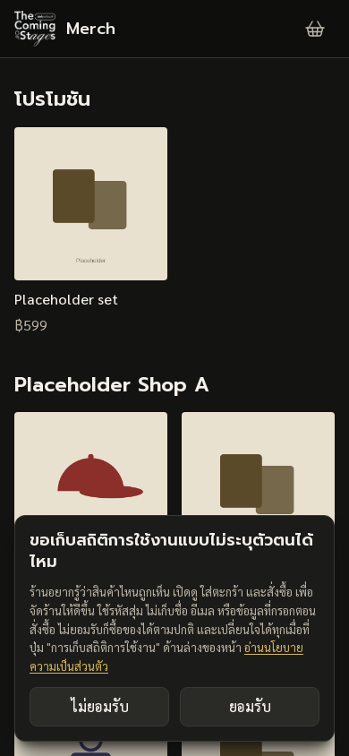

### 1. เลือกสินค้า

1. หน้าแรกแสดงสินค้าแยกตามร้าน ถ้ามีโปรโมชันจะอยู่บนสุดในหัวข้อ "โปรโมชัน"
2. แตะรูปสินค้าเพื่อเปิดรายละเอียด
3. ถ้าสินค้ามีหลายแบบ (เช่นสีหรือไซซ์) ให้เลือกในช่อง "ตัวเลือก" แบบที่ขึ้นว่า "สินค้าหมด" เลือกไม่ได้
4. กดปุ่ม + หรือ − เพื่อตั้งจำนวน ราคารวมจะเปลี่ยนตาม
5. กด "ใส่ตะกร้า" ถ้าจะปิดโดยไม่ใส่ กด × มุมขวาบน

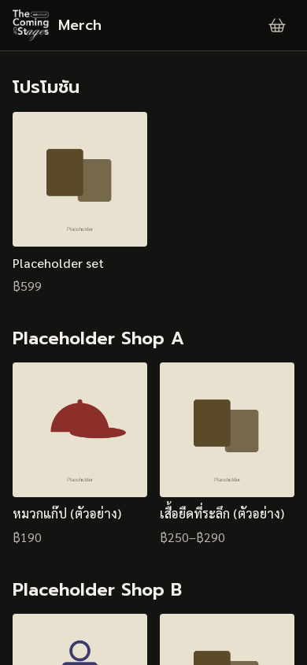 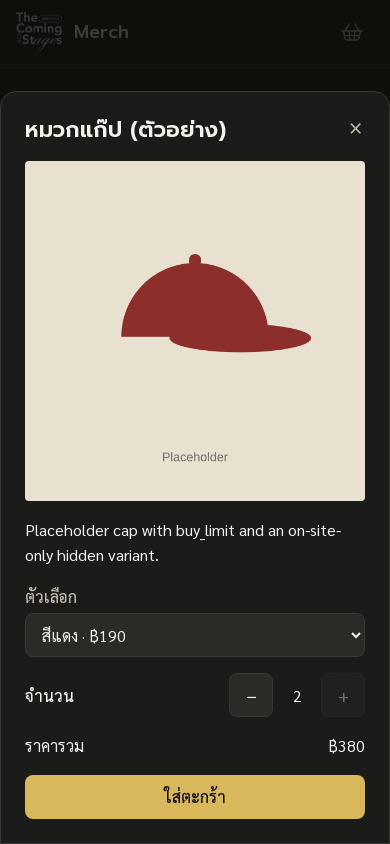

สินค้าบางอย่างจำกัดจำนวนต่อหนึ่งคำสั่งซื้อ พอถึงจำนวนสูงสุด ปุ่ม + จะกดไม่ได้ ถ้าในตะกร้ามีครบแล้ว จะขึ้นข้อความ "จำกัด N ชิ้นต่อคำสั่งซื้อ ใส่ตะกร้าครบแล้ว"

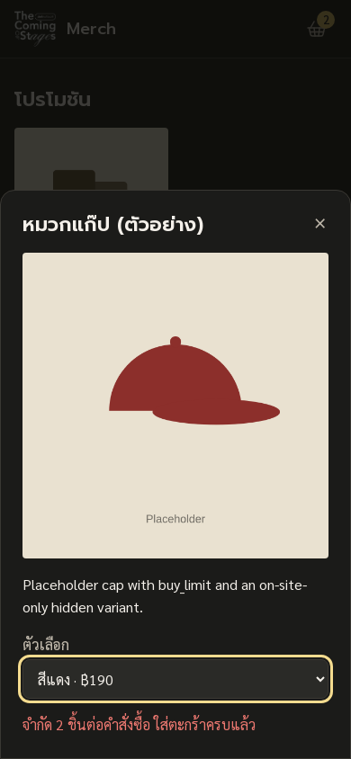

### 2. ซื้อโปรโมชันแบบเซ็ต

โปรโมชันคือชุดสินค้าราคาเดียว เช่น "เสื้อ 2 ตัว กับพวงกุญแจ 1 อัน ในราคาเดียว"

1. แตะการ์ดโปรโมชัน
2. แต่ละรายการในเซ็ตบอกว่าต้องเลือกกี่ชิ้น เช่น "เลือก 2 ชิ้น" ใต้รายการมีตัวนับ "เลือกแล้ว 0 จาก 2"
3. กด + ที่แบบที่ต้องการ เลือกคละแบบได้ เช่น ไซซ์ S หนึ่งตัวกับไซซ์ M หนึ่งตัว
4. เมื่อเลือกครบทุกรายการ ปุ่ม "ใส่ตะกร้า" จะกดได้

ถ้าเลือกครบแล้วอยากเปลี่ยนแบบ กด − ที่แบบเดิมก่อน แล้วกด + ที่แบบใหม่

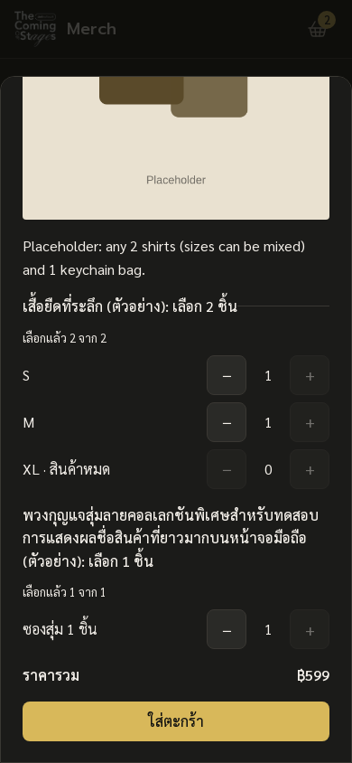

### 3. ดูตะกร้า

- ไอคอนตะกร้ามุมขวาบนมีตัวเลขบอกจำนวนชิ้นในตะกร้า แตะเพื่อไปหน้าชำระเงิน เซ็ตนับตามจำนวนชิ้นในเซ็ต เช่น เซ็ตเสื้อ 2 ตัวกับพวงกุญแจ 1 อัน นับเป็น 3 ชิ้น
- จะเอาของออกจากตะกร้า ไปที่หน้าชำระเงินแล้วกด "ลบ" ที่รายการนั้น (กดได้ในขั้นที่ ① เท่านั้น) อยากเปลี่ยนจำนวน ให้ลบแล้วใส่ตะกร้าใหม่
- ปิดหน้าเว็บหรือโหลดใหม่ ของในตะกร้ายังอยู่
- เมื่อมีของในตะกร้า แถบสีทองจะขึ้นที่ด้านล่างจอ บอกจำนวนชิ้นและยอดรวม กด "ชำระเงิน" ในแถบนั้นก็ได้

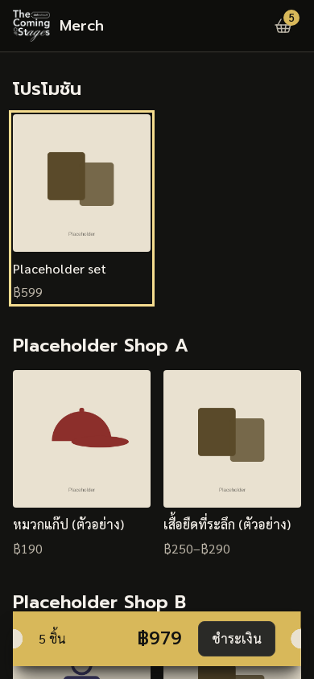

### 4. ชำระเงิน

หน้าชำระเงินมีสามขั้น ด้านบนเป็นสรุปสินค้า ค่าส่ง และยอดรวมที่ต้องโอน

ขั้นที่ ① กรอกข้อมูล

1. กดปุ่มของ Google ที่เขียนว่า "ดำเนินการต่อด้วย Google" แล้วเลือกบัญชี
2. กรอกชื่อ นามสกุล ชื่อเล่น และเบอร์โทร 10 หลัก ขึ้นต้นด้วย 0 เช่น 0812345678 แนะนำให้ใส่ LINE ID ด้วย เพราะถ้าต้องคืนเงิน ร้านจะติดต่อทาง LINE อีเมลมาจากบัญชี Google แก้ไม่ได้
3. ใส่รหัสไปรษณีย์ 5 หลัก แล้วเลือกตำบล/แขวงจากรายการ อำเภอและจังหวัดจะขึ้นเอง
4. ใส่บ้านเลขที่ ซอย ถนน ด้านล่างจะแสดงที่อยู่เต็มให้ตรวจ
5. กด "ถัดไป" ถ้ามีช่องไหนผิด ช่องนั้นจะขึ้นกรอบแดงพร้อมข้อความบอกว่าต้องแก้อะไร พอแก้แล้วข้อความจะหายไป

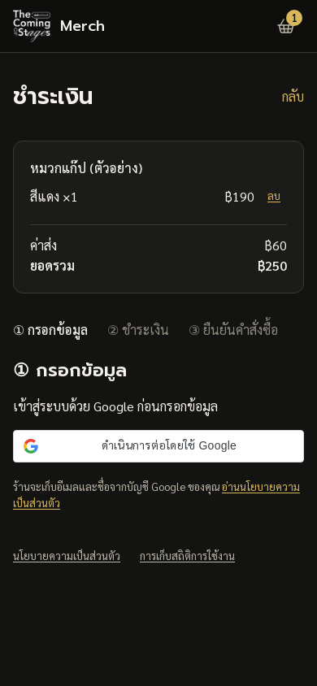 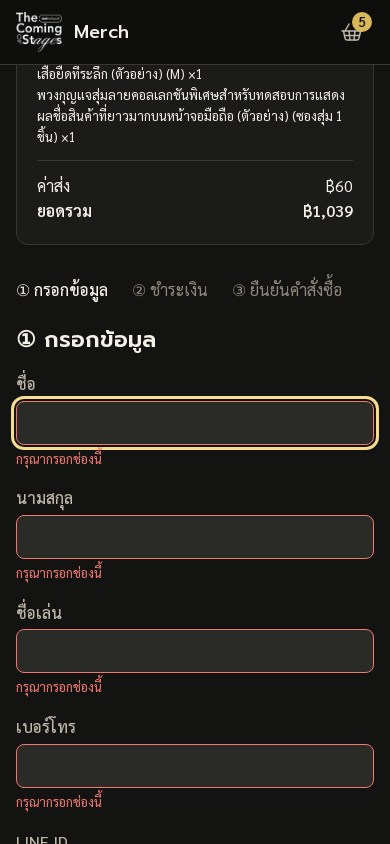 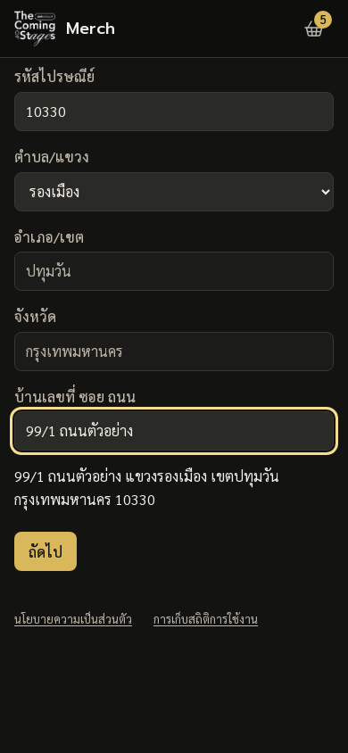

ถ้าเคยสั่งมาก่อน ข้อมูลจากคำสั่งซื้อครั้งล่าสุดจะกรอกไว้ให้ แก้ได้ทุกช่องยกเว้นอีเมล

ขั้นที่ ② ชำระเงิน

1. หน้าจอแสดง QR พร้อมเพย์ที่ใส่ยอดเงินไว้แล้ว และชื่อบัญชีที่รับเงิน
2. สแกน QR ด้วยแอปธนาคาร ถ้าเปิดร้านบนมือถือเครื่องเดียวกับแอปธนาคาร ให้แคปหน้าจอ QR ไว้ แล้วในแอปธนาคารเลือกสแกนจากรูปในเครื่อง
3. ตรวจว่ายอดและชื่อบัญชีในแอปตรงกับบนจอ แล้วโอน
4. กลับมาที่หน้าร้าน แตะช่องเลือกไฟล์ใต้หัวข้อ "อัปโหลดสลิป" แล้วเลือกรูปสลิป
5. ถ้าระบบอ่าน QR บนสลิปได้ จะขึ้นว่า "อ่าน QR จากสลิปแล้ว" และปุ่ม "ถัดไป" จะกดได้
6. ถ้าขึ้นว่า "อ่าน QR จากสลิปไม่ได้" ให้อัปโหลดรูปสลิปที่ชัดกว่าเดิม

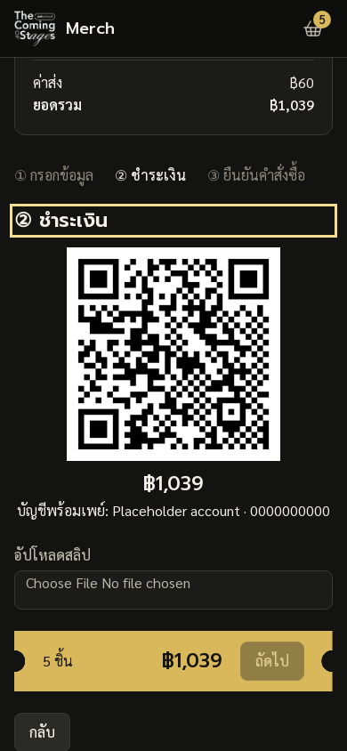 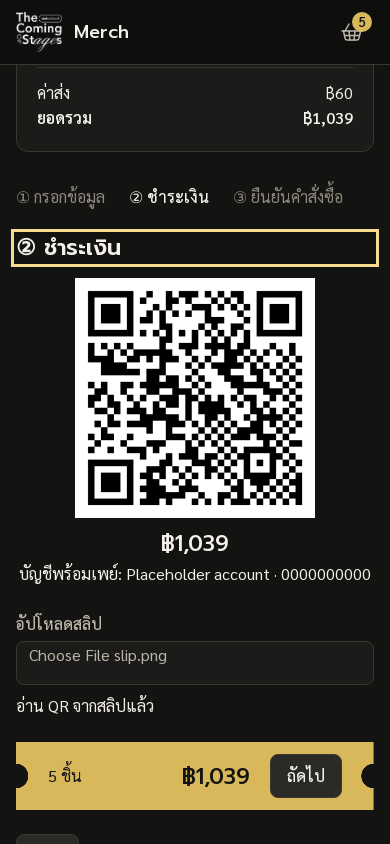

ถ้ากลับมาจากแอปธนาคารแล้วหน้าเว็บโหลดใหม่ ของในตะกร้ายังอยู่ ให้เริ่มจากขั้นที่ ① อีกครั้ง แล้วอัปโหลดสลิปเดิมได้เลย ไม่ต้องโอนซ้ำ

ขั้นที่ ③ ยืนยันคำสั่งซื้อ

1. ตรวจชื่อ เบอร์โทร และที่อยู่อีกครั้ง ถ้าต้องแก้ กด "กลับ"
2. ติ๊กช่อง "ฉันได้อ่านและยอมรับนโยบายความเป็นส่วนตัว" แตะคำว่านโยบายเพื่ออ่านได้ (เปิดในแท็บใหม่ ไม่เสียของที่กรอกไว้) ปุ่ม "สั่งซื้อ" จะกดได้เมื่อติ๊กแล้ว
3. กด "สั่งซื้อ"
4. ขึ้นหน้าต่าง "สั่งซื้อแล้ว" พร้อมหมายเลขคำสั่งซื้อ เช่น #2A9950 จดหรือแคปเก็บไว้ ใช้อ้างอิงเวลาติดต่อร้าน ระบบจะส่งอีเมลยืนยันไปที่อีเมล Google ของคุณด้วย

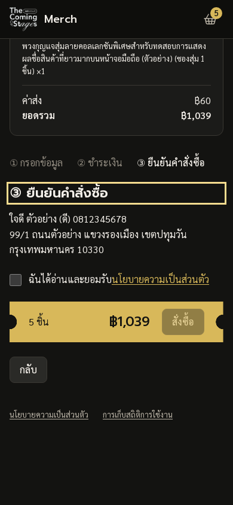 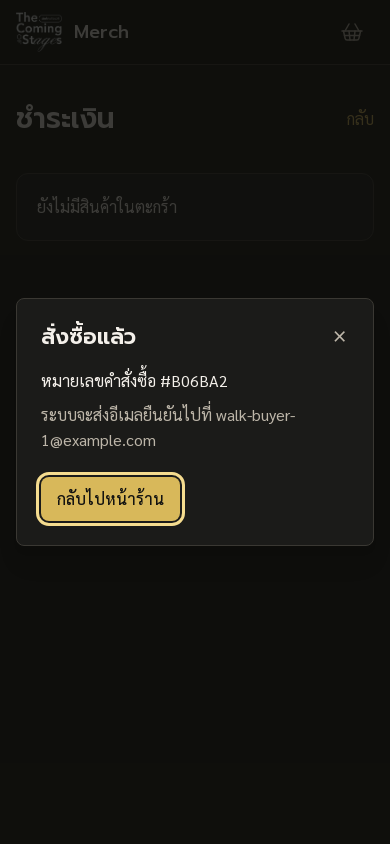

### 5. หลังสั่งซื้อ

- ทีมงานจะตรวจยอดเงินกับบัญชีธนาคารก่อนส่งของ
- เมื่อส่งของแล้ว คุณจะได้อีเมลแจ้งเลขพัสดุ

### ถ้ามีปัญหา

| ข้อความที่เห็น | ความหมาย | ทำอย่างไร |
|---|---|---|
| สินค้าบางรายการหมด เราปรับตะกร้าให้แล้ว | ระหว่างที่อยู่หน้าชำระเงิน มีคนซื้อของชิ้นนั้นไปจนหมด | ตรวจตะกร้าและยอดใหม่ก่อนโอน QR จะเปลี่ยนตามยอดใหม่เอง |
| สลิปนี้ใช้กับคำสั่งซื้ออื่นแล้ว | สลิปนี้เคยใช้สั่งซื้อไปแล้ว | แต่ละคำสั่งซื้อต้องโอนแยกกัน โอนตามยอดบนจอ แล้วอัปโหลดสลิปของการโอนครั้งนี้ |
| สินค้าบางรายการหมดก่อนบันทึกคำสั่งซื้อ | โอนเงินแล้ว แต่ของหมดก่อนกดสั่งซื้อเสร็จ | ไม่ต้องโอนซ้ำ ร้านจะติดต่อทาง LINE เพื่อคืนเงิน |
| หมดเวลาเข้าสู่ระบบ | ไม่ได้ใช้งานนานจนระบบออกจากบัญชีให้ | เข้าสู่ระบบด้วย Google อีกครั้ง ข้อมูลที่กรอกไว้ยังอยู่ |

## ส่วนที่ 2: ดูแลร้านผ่านแดชบอร์ด

### ก่อนเริ่ม

- แดชบอร์ดเปิดได้เฉพาะเครื่องที่ต่อเครือข่าย Tailscale ของทีม ขอลิงก์และสิทธิ์เข้าเครือข่ายจากคนดูแลระบบ
- ไม่ต้องล็อกอิน ทุกคนที่เปิดได้แก้ข้อมูลร้านได้ทั้งหมด จึงอย่าส่งลิงก์ให้คนนอกทีม
- เมนูอยู่ทางซ้าย บนมือถือกด "Menu" มุมขวาบน

### 1. ตั้งร้านและเพิ่มสินค้า (เมนู Products)

เพิ่มร้าน

1. กด "+ Add shop" ใส่ชื่อร้าน แล้วบันทึก ชื่อร้านห้ามซ้ำกับร้านที่มีอยู่ เพราะการนำเข้าจากไฟล์ใช้ชื่อร้านจับคู่
2. เลือกร้านที่จะทำงานจากช่อง "Shop" ชื่อร้านที่เลือกจะขึ้นเป็นหัวข้อ ข้างชื่อมีปุ่ม "Rename" สำหรับเปลี่ยนชื่อ และ "Archive" สำหรับเก็บร้าน

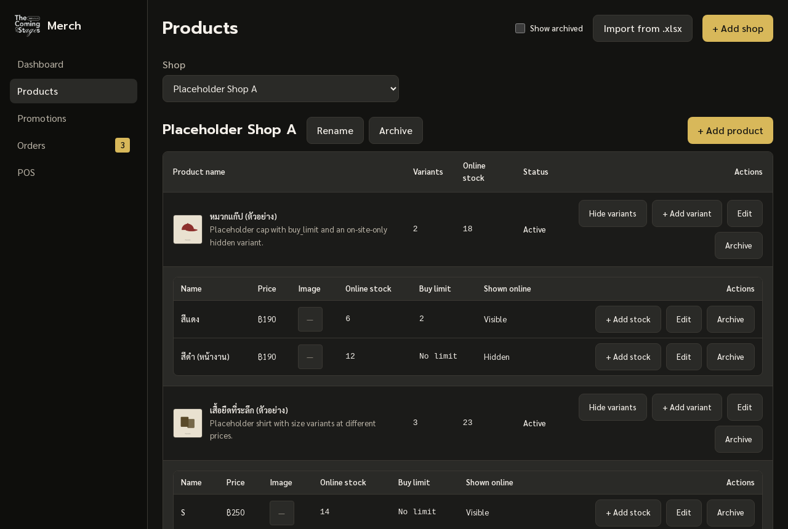

เพิ่มสินค้า

1. กด "+ Add product"
2. ใส่ชื่อสินค้า คำอธิบาย และรูป จะวางลิงก์รูปหรือกด "Upload from device" เพื่อเลือกรูปจากเครื่องก็ได้ ระบบย่อรูปและเก็บไว้ให้เอง
3. ใส่แบบสินค้า (variant) เช่น สีแดง ไซซ์ M ฟอร์มมีช่องแบบสินค้าให้ 2 ช่อง ถ้าใช้แบบเดียว กด "Remove variant" ที่ช่องที่ไม่ใช้ ไม่อย่างนั้นจะบันทึกไม่ได้ แต่ละแบบมี
   - ราคา (บาท เต็มจำนวน)
   - Buy limit: จำนวนสูงสุดที่ซื้อได้ต่อหนึ่งคำสั่งซื้อ ใส่ 0 ถ้าไม่จำกัด
   - Visible to online: ติ๊กออกถ้าแบบนี้ขายเฉพาะหน้างาน ไม่ขายออนไลน์ (ในตารางคอลัมน์นี้ชื่อ "Shown online")
4. บันทึก

ในตารางสินค้า แบบสินค้าจะแสดงอยู่ใต้สินค้าแต่ละตัว (กด "Hide variants" เพื่อซ่อน) กด "+ Add variant" เพื่อเพิ่มแบบใหม่

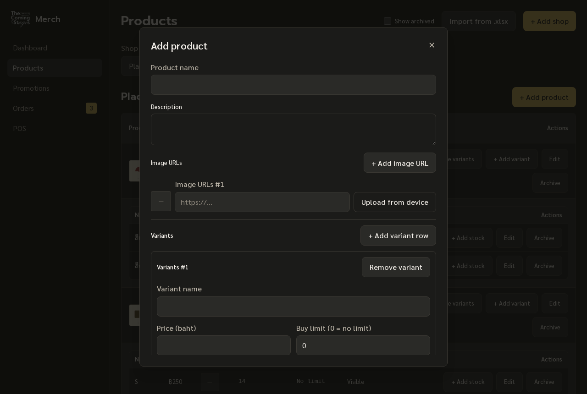

### 2. เติมสต็อก

1. ในตารางแบบสินค้า กด "+ Add stock" ที่แบบที่ต้องการ
2. ใส่จำนวนที่จะเพิ่ม ถ้าต้องการลดสต็อกให้ใส่เลขติดลบ เช่น -2
3. บันทึก ตัวเลขในคอลัมน์ "Online stock" จะเปลี่ยนทันที

ร้านออนไลน์ขายได้ไม่เกินสต็อกนี้ ของหมดเมื่อไหร่ ปุ่มในร้านจะขึ้นว่า "สินค้าหมด" เอง

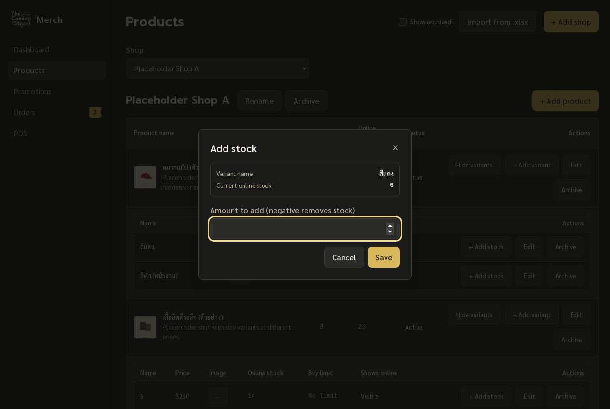

### 3. นำเข้าร้านและสินค้าจากไฟล์ .xlsx

ถ้ามีรายการสินค้าเยอะ ทำใน Google Sheets แล้วนำเข้าทีเดียวได้

1. ที่หน้า Products กด "Import from .xlsx" แล้วกด "Download template" จะได้ไฟล์ที่มีหัวคอลัมน์ครบ อัปโหลดไฟล์นี้ขึ้น Google Drive แล้วเปิดด้วย Google Sheets
2. หนึ่งแถวคือสินค้าหนึ่งแบบ คอลัมน์ที่ต้องมีคือ shop, product, variant, price
3. คอลัมน์อื่นใส่หรือไม่ใส่ก็ได้: online_stock, buy_limit, visible_to_online (TRUE หรือ FALSE ถ้าเว้นว่างถือว่า TRUE), description, product_images (ลิงก์รูป คั่นด้วยเว้นวรรค), variant_image
4. ช่อง shop, product, description หรือ product_images ที่เว้นว่าง ระบบจะใช้ค่าจากแถวบน ใช้เซลล์ที่รวมกัน (merge) ได้
5. ใน Google Sheets ไปที่ File → Download → Microsoft Excel (.xlsx)
6. กลับมาที่แดชบอร์ด เลือกไฟล์ในช่อง "Sheet (.xlsx)"
7. ถ้ามีจุดผิด ระบบจะบอกเป็นรายแถว เช่น "Row 3: variant is empty" ให้แก้ในชีตแล้วเลือกไฟล์ใหม่
8. ถ้าไม่มีจุดผิด จะขึ้นสรุปว่าจะสร้างกี่ร้าน กี่สินค้า กี่แบบ กด "Import"

ถ้าร้านชื่อเดียวกันมีอยู่แล้ว สินค้าใหม่จะไปอยู่ในร้านนั้น ถ้าสินค้าชื่อซ้ำกับที่มีในร้านแล้ว ระบบจะไม่นำเข้าเลยสักแถว จึงนำเข้าไฟล์เดิมซ้ำโดยบังเอิญไม่ได้ หน้าสรุปก่อนกด "Import" ยังไม่ได้ตรวจเรื่องนี้ ข้อความจะขึ้นหลังกด "Import"

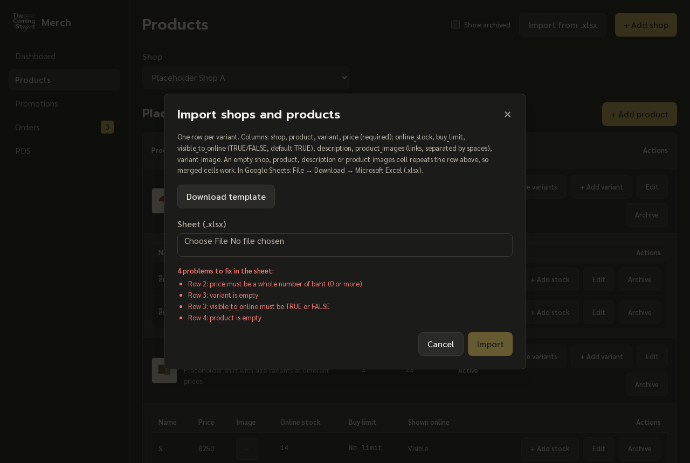

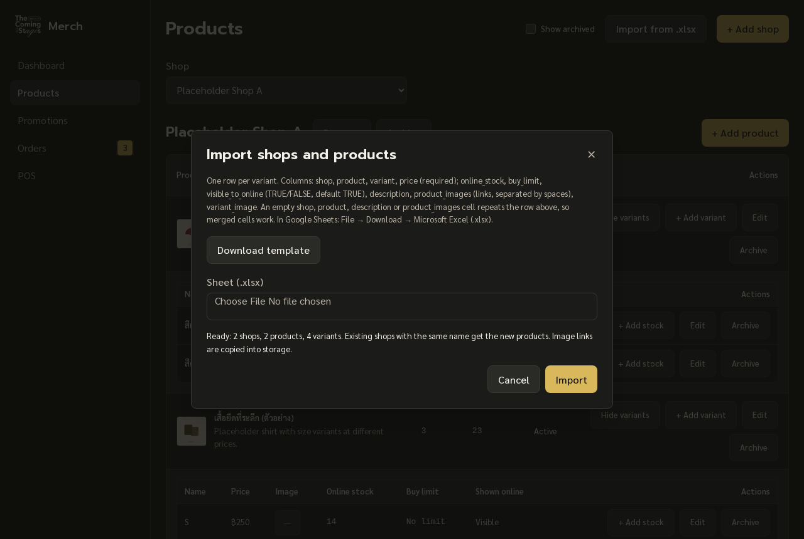

### 4. ทำโปรโมชัน (เมนู Promotions)

1. กด "New set"
2. ใส่ชื่อ คำอธิบาย รูป และราคาของทั้งเซ็ตใน "Set price (baht)"
3. ในส่วน Items เลือกสินค้า (เลือกจากร้านไหนก็ได้) ติ๊กแบบที่ให้ลูกค้าเลือกได้ แล้วใส่ "How many in one set" กด "+ Add item" เพื่อเพิ่มสินค้าอีกรายการ
4. ช่อง "On sale" ติ๊กไว้ให้แล้ว เซ็ตจะขึ้นในร้านทันทีที่บันทึก ถ้ายังไม่อยากให้ขึ้น ติ๊กออกก่อน
5. บันทึก

แบบที่ติ๊ก "Visible to online" ออก หรือมี Buy limit ถ้าอยู่ในเซ็ต ลูกค้าออนไลน์ซื้อผ่านเซ็ตได้ และไม่นับ Buy limit

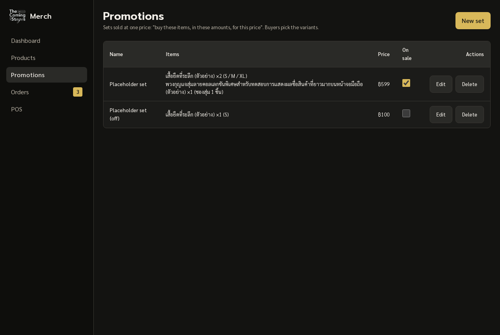

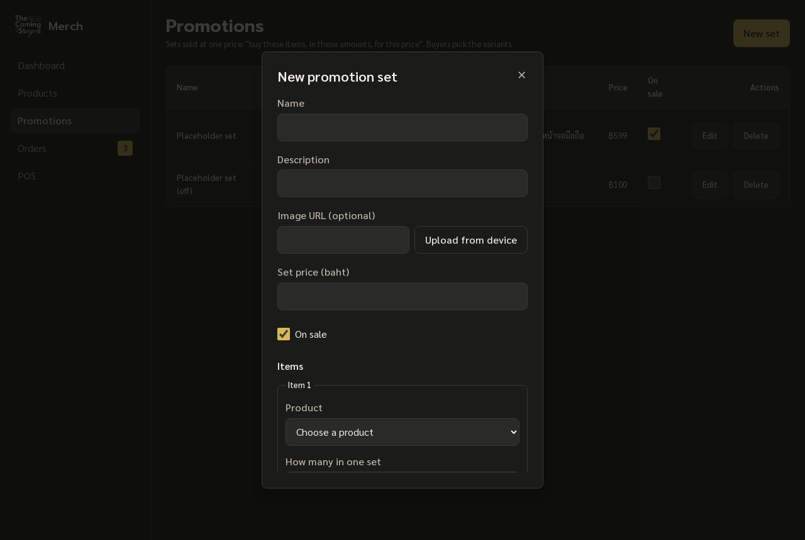

### เก็บร้าน สินค้า หรือแบบสินค้า (Archive)

1. ลดสต็อกออนไลน์ให้เป็น 0 ก่อน (กด "+ Add stock" แล้วใส่เลขติดลบ) ถ้ายังมีสต็อก ระบบจะไม่ให้เก็บ
2. กด "Archive" ถ้าสินค้าหรือแบบนั้นอยู่ในโปรโมชัน ระบบจะบอกก่อนว่าโปรโมชันไหนจะถูกลบหรือเปลี่ยน กดยืนยันแล้วจึงจะเก็บ
3. ของที่เก็บแล้วดูได้โดยติ๊ก "Show archived" แต่ยังเอากลับมาไม่ได้

### 5. ตรวจเงินและส่งของ (เมนู Orders)

ตัวเลขข้างเมนู Orders คือจำนวนคำสั่งซื้อที่ยังไม่ได้ส่งของ ทั้งที่รอตรวจเงินและตรวจแล้ว ไม่นับรายการที่ Reject แล้ว

คำสั่งซื้อที่ Reject แล้วจะไม่แสดงเมื่อตัวกรองเป็น "All" ถ้าจะดู ให้เลือก "Payment status" เป็น REJECTED

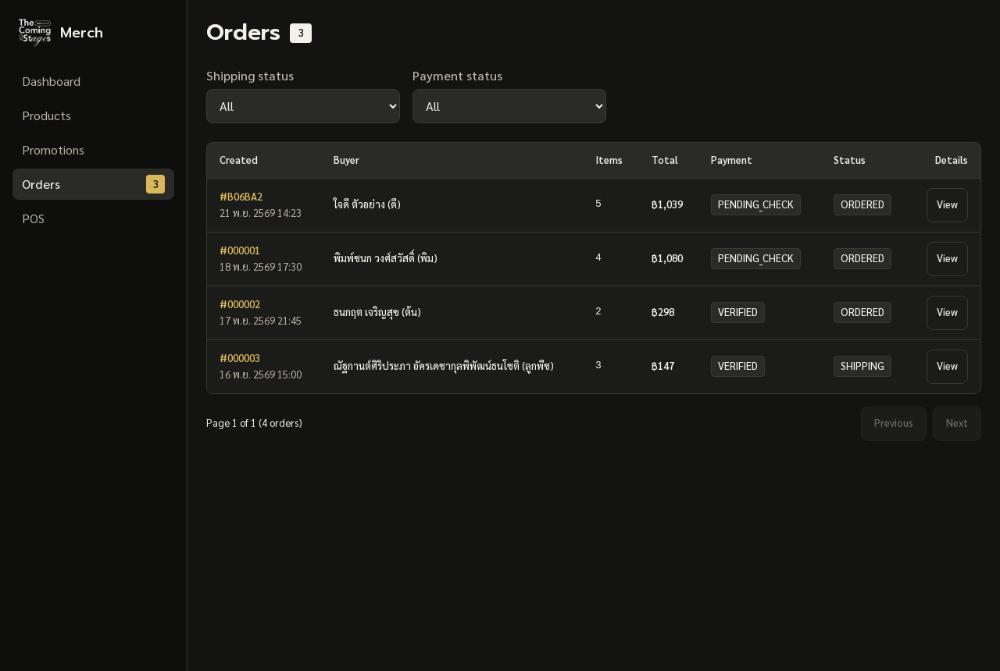

ตรวจการโอนเงิน

1. เปิดเมนู Orders แล้วกด "View" ที่คำสั่งซื้อ
2. ในส่วน "Payment verification" มีเลขอ้างอิงรายการ ("Transaction reference") พร้อมปุ่ม "Copy" และ QR ที่วาดจาก QR บนสลิปของลูกค้า สแกน QR นั้นด้วยเมนูตรวจสลิปในแอปธนาคาร ถ้าเปิดแดชบอร์ดบนมือถือเครื่องเดียวกับแอปธนาคาร ให้แคปหน้าจอ QR แล้วสแกนจากรูป
3. เทียบยอดและบัญชีที่รับเงินกับ "Expected total" ถ้าเป็นไปได้ ให้ดูในบัญชีธนาคารของร้านด้วยว่าเงินเข้าจริง เพราะสลิปปลอมได้
4. ถ้าตรง กด "Verify payment" แล้วยืนยัน กดแล้วย้อนกลับไม่ได้ และจะ Reject รายการนี้ไม่ได้อีก
5. ถ้าไม่ตรง กด "Reject" สินค้าจะคืนกลับเข้าสต็อกออนไลน์ และย้อนกลับไม่ได้ จากนั้นติดต่อลูกค้าเอง

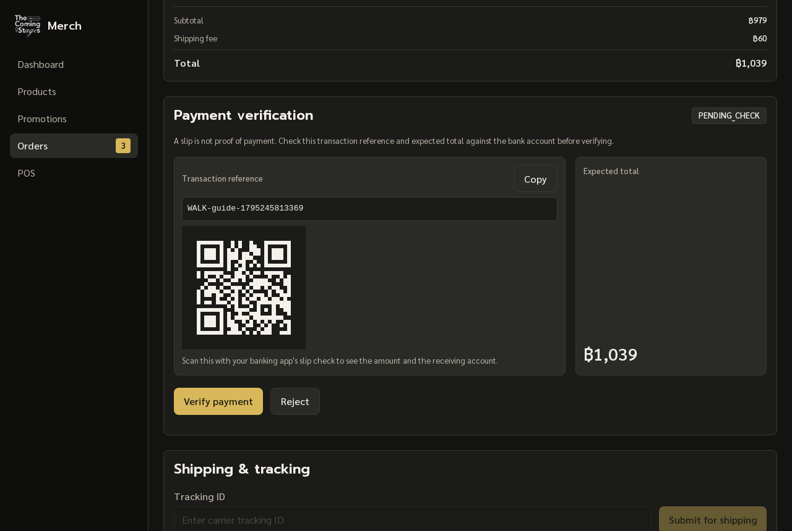

ส่งของ

1. เมื่อตรวจเงินแล้ว ส่วน "Shipping & tracking" จะใช้ได้
2. ใส่เลขพัสดุใน "Tracking ID" แล้วกด "Submit for shipping" และยืนยัน
3. สถานะจะเปลี่ยนเป็น SHIPPING และลูกค้าได้อีเมลแจ้งเลขพัสดุ

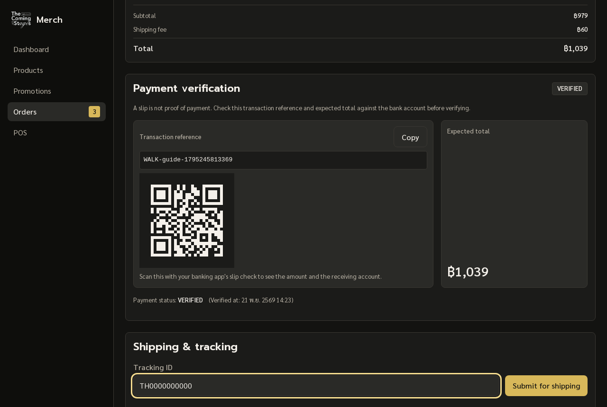

คืนเงิน

ถ้าคำสั่งซื้อขึ้นสถานะ REFUND_DUE แปลว่าลูกค้าโอนเงินแล้ว แต่ของหมดก่อนบันทึกคำสั่งซื้อ จะไม่มีการส่งของ ให้ตรวจเงินในบัญชี แล้วติดต่อลูกค้าทาง LINE เพื่อโอนคืน เสร็จแล้วกด "Mark refunded"

### 6. ความหมายของสถานะ

คำสั่งซื้อแต่ละรายการมีสองสถานะ คือสถานะเงิน (คอลัมน์ Payment ตัวกรอง "Payment status") กับสถานะการส่ง (คอลัมน์ Status ตัวกรอง "Shipping status")

| สถานะเงิน | ความหมาย |
|---|---|
| PENDING_CHECK | ลูกค้าส่งสลิปแล้ว รอทีมตรวจเงิน |
| VERIFIED | ตรวจเงินแล้ว พร้อมส่งของ |
| REJECTED | ตรวจแล้วไม่ผ่าน หรือคืนเงินแล้ว |
| REFUND_DUE | ต้องโอนเงินคืนลูกค้า |

| สถานะการส่ง | ความหมาย |
|---|---|
| ORDERED | ยังไม่ได้ส่งของ (ถ้าสถานะเงินเป็น REJECTED จะไม่มีการส่ง) |
| SHIPPING | ส่งของแล้ว มีเลขพัสดุ |
| ARRIVED | ถึงมือลูกค้าแล้ว ตอนนี้ยังเปลี่ยนเป็นสถานะนี้ไม่ได้ |

### ยังทำไม่ได้ในตอนนี้

- หน้า POS สำหรับขายหน้างานยังไม่เสร็จ
- หน้า Dashboard ยังไม่มีสรุปยอดขาย
- ยังไม่มีปุ่มเอาร้านหรือสินค้าที่เก็บ (Archive) กลับมา และยังไม่มีปุ่มเปลี่ยนสถานะเป็น "ถึงแล้ว" (ARRIVED)
